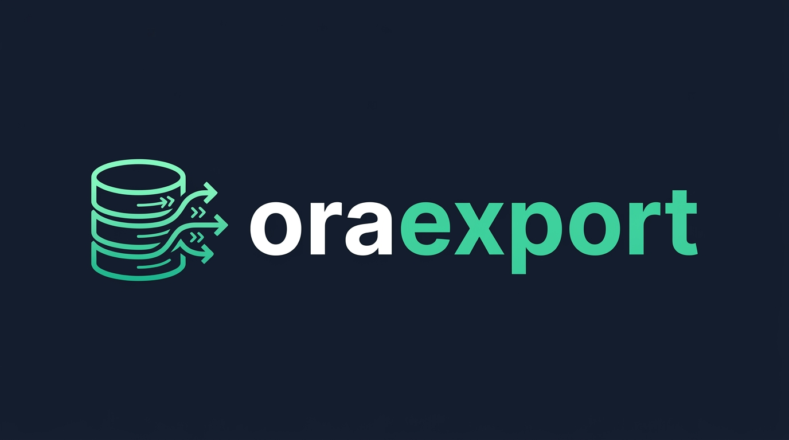
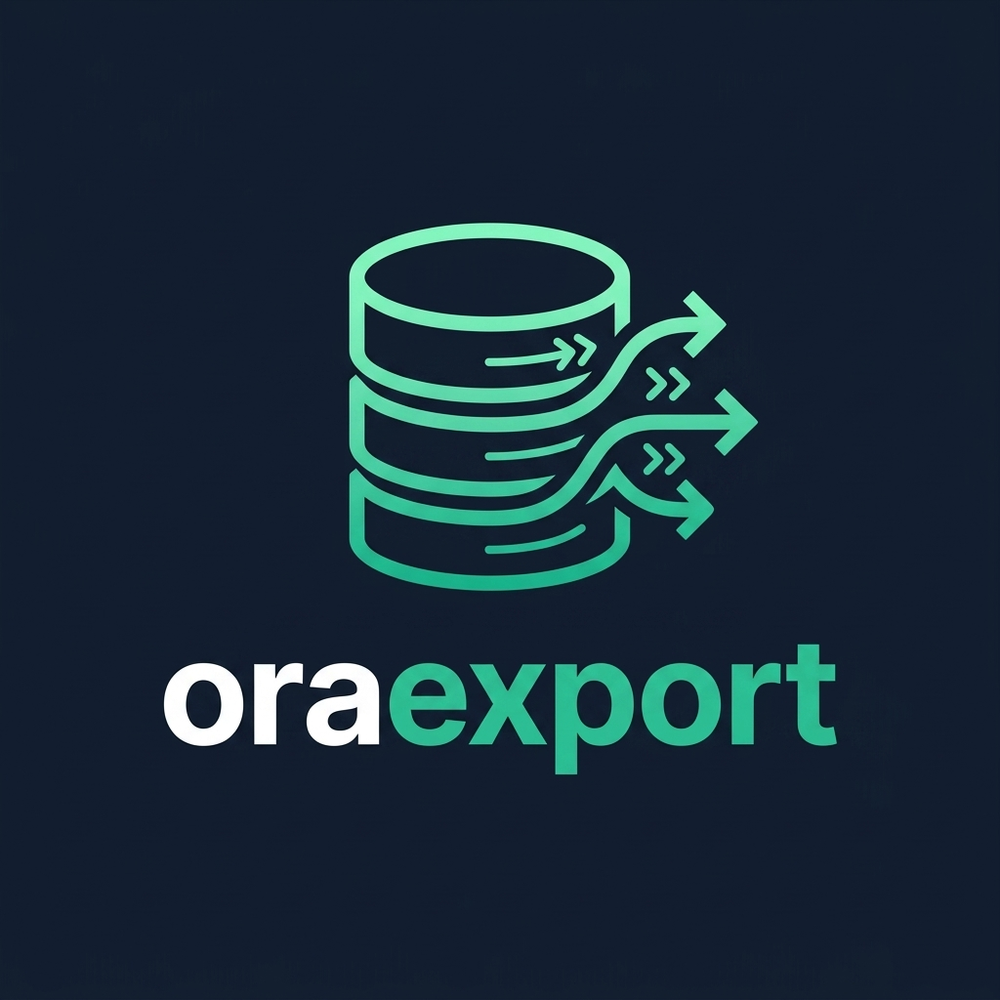
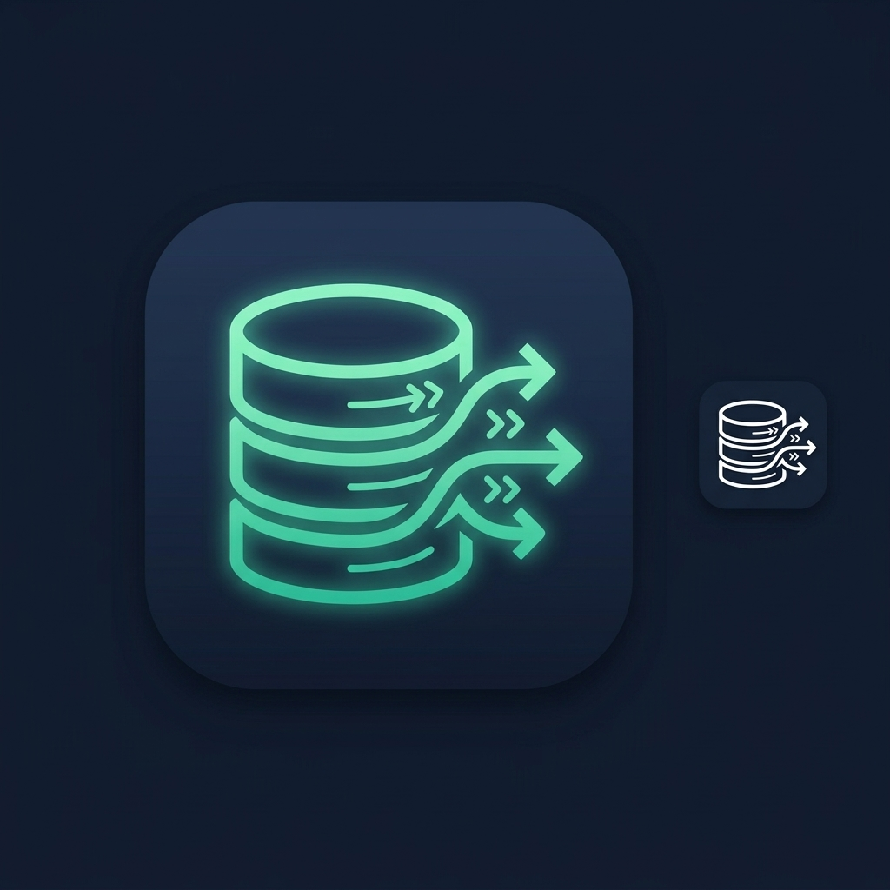

# oraexport Brand & Style Guide

A comprehensive brand style guide and asset reference for **oraexport** — Oracle Data Pump Export & Operations Management.

---

## 1. Brand Concept & Core Identity

**oraexport** automates and manages Oracle Data Pump export operations. The visual identity bridges enterprise database resilience with high-velocity data streaming.

- **The Database Cylinder**: Grounded in classic relational database iconography, representing schema data, tablespaces, and Oracle instances.
- **Dynamic Pump & Flow Arrows**: Outgoing directional vectors representing continuous Data Pump extraction, export jobs, and pipeline velocity.
- **Two-Tone Wordmark**: Distinguishes **`ora`** (the Oracle database core) and **`export`** (the operational capability and pipeline). Pure, minimalist branding without secondary taglines.

---

## 2. Logo Variants

### A. Horizontal Sidebar Lockup (Primary UI Header)
Optimized specifically for application navigation sidebars, headers, and top banners.



- **Usage**: Sidebar top-left branding, desktop app top navigation bar, GitHub README header banners.
- **Composition**: Left-aligned database stream mark + bold `oraexport` typography (`ora` in white, `export` in mint green). Clean, zero tagline clutter.

---

### B. Primary Stacked Mark
Ideal for documentation covers, splash screens, mobile viewports, and social cards.



- **Usage**: Splash screens, about modals, documentation hero sections, presentation slides.
- **Composition**: Centered large emblem with centered two-tone wordmark below.

---

### C. App Icon & Favicon Mark
Designed for compact containers, browser favicons, desktop dock icons, and notification badges.



- **Usage**: Browser favicon, macOS/Windows application dock icons, PWA mobile icon, CLI terminal avatar.
- **Composition**: High-contrast illuminated emblem centered in a squircle container.

---

### D. Light Mode / Reverse Lockup
Used on light paper docs, exported PDF reports, light mode themes, or print collateral.


- **Usage**: Light theme UI, printable export audit logs, whitepaper documentation.
- **Composition**: Deep slate `ora` + emerald mint `export` on clean off-white / light neutral backgrounds.

---

## 3. Color Palette

The color system directly reflects the dark navy and mint aesthetic established in the application UI:

| Role | Name | HEX | RGB | Semantic Usage |
| :--- | :--- | :--- | :--- | :--- |
| **Primary Brand Accent** | Seafoam / Mint Green | `#10B981` / `#2DD4BF` | `rgb(45, 212, 191)` | "export" text, active states, pipeline arrows, success badges |
| **Brand Surface / Canvas** | Midnight Slate Navy | `#0F172A` | `rgb(15, 23, 42)` | Sidebar background, dark theme panels, logo backdrop |
| **Deep Background** | Void Navy | `#090D16` | `rgb(9, 13, 22)` | Deepest contrast background, dock app container |
| **Primary Text (Dark)** | Pure White | `#FFFFFF` | `rgb(255, 255, 255)` | "ora" text in dark mode, active headings |
| **Primary Text (Light)** | Deep Ink Navy | `#0F172A` | `rgb(15, 23, 42)` | "ora" text in light mode |
| **Border / Secondary** | Cool Slate Gray | `#334155` / `#64748B` | `rgb(51, 65, 85)` | Inactive navigation, subtle borders, card outlines |
| **Light Canvas** | Crisp Neutral Off-White | `#F8FAFC` | `rgb(248, 250, 252)` | Light mode content area background |

---

## 4. Typography Guidelines

- **Primary Font Family**: Clean modern geometric sans-serif:
  - Recommended: **Inter**, **Plus Jakarta Sans**, or **Geist**
  - Fallback: `system-ui, -apple-system, BlinkMacSystemFont, "Segoe UI", Roboto, sans-serif`
- **Wordmark Specs**:
  - `ora`: Weight `700` (Bold), Color `#FFFFFF` (Dark Theme) or `#0F172A` (Light Theme)
  - `export`: Weight `700` (Bold) or `800` (Extra Bold), Color `#10B981` / `#2DD4BF`
  - Letter spacing: `-0.02em` (tight tracking for modern SaaS feel)
  - Alignment: Vertically optical-centered with the database mark.

---

## 5. UI Implementation Snippet

### React / HTML Sidebar Component

```tsx
export function SidebarBrand() {
  return (
    <div className="flex items-center gap-3 px-4 py-5 select-none">
      {/* Icon Squircle / Mark */}
      <div className="flex items-center justify-center w-10 h-10 rounded-xl bg-teal-500/10 border border-teal-500/20 text-teal-400">
        <svg
          className="w-6 h-6 stroke-current fill-none"
          viewBox="0 0 24 24"
          strokeWidth="1.8"
          strokeLinecap="round"
          strokeLinejoin="round"
        >
          {/* Cylinder top */}
          <ellipse cx="10" cy="5" rx="7" ry="2.5" />
          {/* Cylinder body */}
          <path d="M3 5v6c0 1.38 3.13 2.5 7 2.5" />
          <path d="M3 11v6c0 1.38 3.13 2.5 7 2.5" />
          {/* Export pump arrows */}
          <path d="M14 11h7m0 0l-3-3m3 3l-3 3" />
          <path d="M15 17h6m0 0l-2.5-2.5m2.5 2.5l-2.5 2.5" />
        </svg>
      </div>

      {/* Typography Lockup */}
      <div className="text-xl font-bold tracking-tight leading-none">
        <span className="text-white">ora</span>
        <span className="text-teal-400">export</span>
      </div>
    </div>
  );
}
```

---

## 6. Clear Space & Usage Rules

1. **Clear Space**: Always maintain a clear margin around the logo equal to at least the height of the lowercase `o` in `ora`.
2. **Contrast Protection**: Do not place the dark-mode lockup on low-contrast backgrounds. Use the Light Mode variant for white or light grey containers.
3. **Consistency**: Keep the two-tone split consistent (`ora` in neutral high-contrast, `export` in brand mint green). Never split across arbitrary letters.
